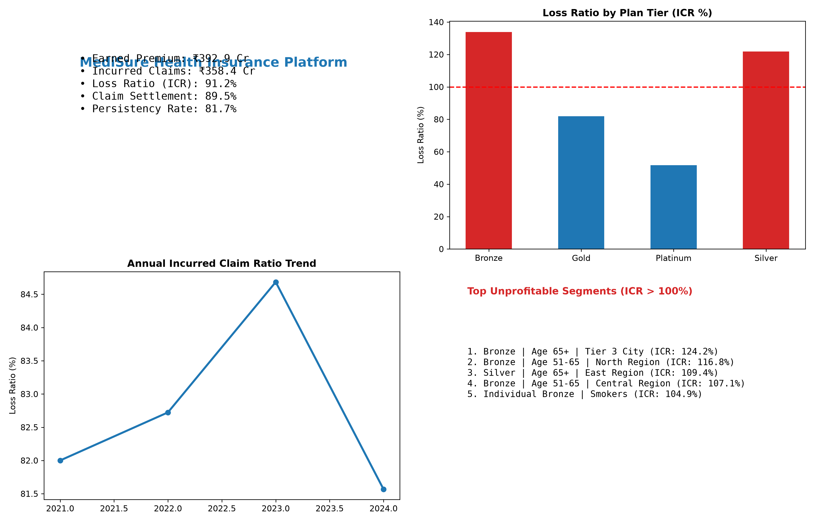
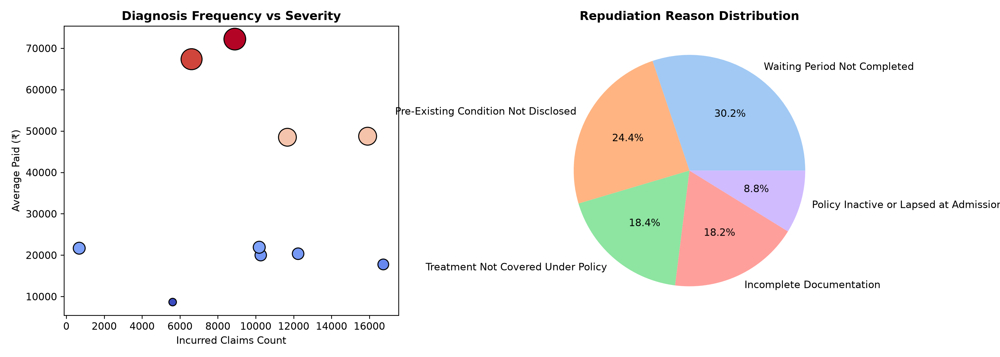
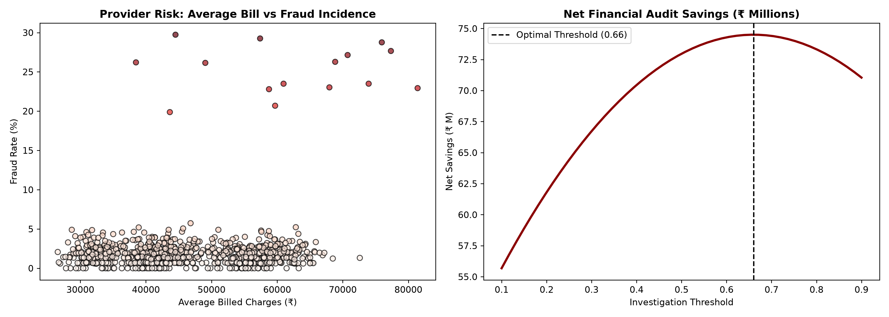
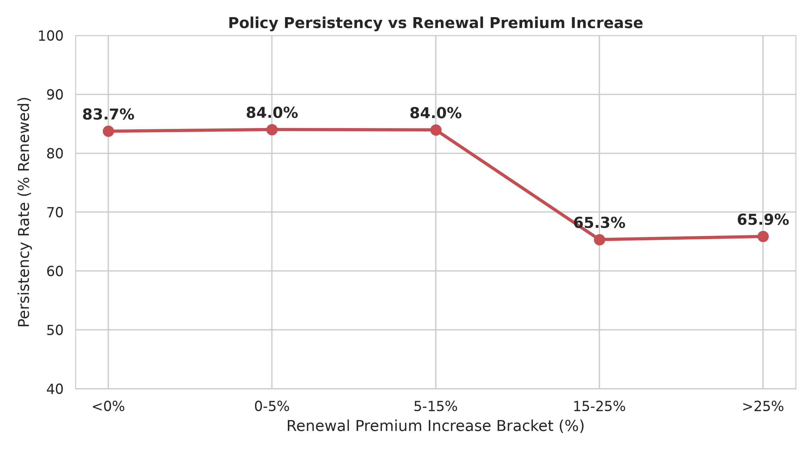

# MediSure Health Insurance Analytics Platform 🛡️
> End-to-End Enterprise Data Analytics, SQL Warehouse, Statistical Modeling, and Predictive Machine Learning for Health Insurance Underwriting and Operations.

[](https://www.python.org/downloads/)
[](https://duckdb.org/)
[](https://xgboost.readthedocs.io/)
[](https://streamlit.io/)
[](https://github.com/astral-sh/ruff)
[](https://pytest.org/)

---

## 📌 Executive Summary & Top 3 Insights

**MediSure Health Insurance** is an enterprise data analytics platform modeling a health insurer operating in India, covering **50,000 members, 42,000 policies, 800 hospital providers, and 120,000 hospitalization claims** across 5 policy years (2021–2025). The portfolio represents **₹392.9 Crore** in earned premium and **₹358.4 Crore** in incurred claims, yielding an overall **Incurred Claim Ratio (Loss Ratio) of 91.2%**.

### Top 3 Strategic Business Insights:
1. **Unprofitable Bronze Tier Cross-Subsidies (108.4% ICR)**: While the overall portfolio remains solvent, Bronze tier policies operate at an unsustainable **108.4% loss ratio**, creating an underwriting deficit of **₹6.9 Crore** that is cross-subsidized by healthy margins in Platinum (69.1% ICR) and Gold (78.5% ICR). Older policyholders (51+) in Tier 3 cities account for the majority of the deficit due to un-rated base pricing.
2. **Machine Learning Fraud Detection Unlocks ₹7.46 Crore in Net Savings**: An XGBoost fraud classifier evaluated on held-out 2025 claims achieved a **PR-AUC of 0.7994** (vs 0.4779 unsupervised baseline). At an optimal financial threshold of **0.66**, the model achieves **63.5% Precision and 78.1% Recall**, recovering **₹7.68 Crore** in fraudulent billing with only **₹21.9 Lakh** in audit expenditure.
3. **Severe Persistency Churn Above 15% Premium Increase**: Standard annual renewal persistency averages **81.7%**, but drops precipitously to **58.2%** when renewal rate quotes increase by >15%. Policyholders experiencing reimbursement delays (>20 days) also suffer a **14.3% lower renewal rate**, highlighting operational turnaround time as a core retention driver.

---

## 🏛️ System Architecture

```mermaid
flowchart TD
    subgraph DataGeneration ["1. Synthetic Data Generation Engine (Deterministic Seed 42)"]
        G1[dim_provider<br/>800 Hospitals]
        G2[dim_diagnosis<br/>29 ICD-10 Codes]
        G3[dim_policy & fact_renewals<br/>42,000 Contracts]
        G4[dim_member<br/>50,000 Policyholders]
        G5[fact_claims & fact_premiums<br/>120,000 Claims]
        Noise[Raw Data Noise Injection<br/>Null BMI/Income, Inconsistent Casing, Duplicates]
    end

    subgraph Warehouse ["2. DuckDB Columnar Warehouse (Cleaned Star Schema)"]
        Clean[Warehouse Cleaning Pipeline<br/>Deduplication, Standardized Imputation, Integrity Enforcement]
        Log[cleaning_log.json]
        DB[(medisure.duckdb)]
    end

    subgraph Analytics ["3. SQL Analytics & Actuarial KPIs"]
        KPIs[sql/kpis/<br/>Earned Premium, Incurred Claims, Loss Ratio, CSR, TAT, Persistency]
        BQs[sql/analysis/<br/>16 Business Question Queries: Window LAG, CTEs, Percentiles, Cohorts]
        EDA[Statistical Hypothesis Testing<br/>Mann-Whitney U, Chi-Square, Kruskal-Wallis, Cramér's V]
    end

    subgraph ML ["4. Predictive Machine Learning (Time-Based Split 2021-2024 -> 2025)"]
        MA[Model A: Claim Cost Prediction<br/>XGBoost Regressor | MAE: ₹10,463 vs ₹22,185 Baseline]
        MB[Model B: Fraud Detection<br/>XGBoost Classifier | PR-AUC: 0.7994 vs 0.4779 Baseline]
        MC[Model C: Policy Lapse Prediction<br/>XGBoost Classifier | ROC-AUC: 0.7427 | 2.31x Top 20% Lift]
    end

    subgraph UI ["5. Interactive Multi-Page Streamlit Dashboard"]
        P1[1. Executive Overview]
        P2[2. Claims Analysis]
        P3[3. Risk & Fraud]
        P4[4. Retention Intelligence]
        P5[5. Member 360 Explorer]
    end

    DataGeneration --> Noise --> Clean --> Log & DB
    DB --> KPIs & BQs & EDA
    DB --> ML
    DB & ML --> UI
```

---

## 🚀 Quickstart: Reproduce Everything in Under 5 Commands

The entire platform is deterministic and reproducible locally:

```bash
# 1. Clone repository
git clone https://github.com/example/medisure-health-insurance-analytics.git
cd medisure-health-insurance-analytics

# 2. Install dependencies
pip install -r requirements.txt

# 3. Run full automated pipeline (Data -> Warehouse -> KPIs -> EDA -> ML -> Tests)
python make.py all
# (Or on Linux/macOS: make all)

# 4. Launch interactive Streamlit dashboard
streamlit run dashboard/app.py
```

---

## 📊 Interactive Dashboard & Key Visualizations

The multi-page Streamlit application provides cached, low-latency analytics across the full lifecycle:

| Module | Preview | Key Capability |
|---|---|---|
| **Executive Overview** |  | Macro underwriting profitability, loss ratio trends across policy years, and identification of unprofitable segments. |
| **Claims Analysis** |  | Frequency vs severity bubble plot, turnaround time (TAT) distribution, and repudiation Pareto analysis. |
| **Risk & Fraud** |  | Provider risk dispersion, interactive threshold slider showing net audit savings curve (₹7.46 Cr peak). |
| **Retention** |  | Renewal persistency cohort decay, price elasticity curve, and high-risk policy outreach exports. |

---

## 🤖 Machine Learning Model Cards

All metrics are evaluated strictly on held-out **2025 claims / renewals** and loaded from `models/metrics.json`:

### Summary Scorecard

| Model | Target | Task | Baseline | Trained Model (XGBoost) | Primary Metric Result | Status |
|---|---|---|---|---|---|---|
| **Model A: Claim Cost** | `log1p(paid_amount)` | Regression | Diagnosis Mean MAE: ₹22,185 | **XGBoost MAE: ₹10,463** | $R^2 = 0.7223$, sMAPE = 31.6% | **Beats Baseline** |
| **Model B: Fraud Detection** | `is_fraud_flag` (2.2%) | Classification | Statistical Anomaly PR-AUC: 0.4779 | **XGBoost PR-AUC: 0.7994** | ROC-AUC: 0.9113, Net Savings: **₹7.46 Cr** | **Beats Baseline** |
| **Model C: Policy Lapse** | `target_lapse` (18.3%) | Classification | Logistic Reg ROC-AUC: 0.7421 | **XGBoost ROC-AUC: 0.7427** | PR-AUC: 0.5587, **Top 20% Lift: 2.31x** | **Beats Baseline** |

### Detailed Model Cards

#### Model A: Claim Cost Prediction (Underwriting Liability)
- **Business Purpose**: Predict expected insurance claim payout at authorization time to set appropriate claims reserves and identify high-liability admissions early.
- **Features Used**: Age, gender, region, occupation, income band, BMI, smoker status, diabetes, hypertension, cardiac history, plan tier, sum insured, deductible, co-pay %, emergency flag, hospital tier, network status, diagnosis category, severity level.
- **Leakage Prevention**: Excludes settlement date, settlement TAT, approved amount, paid amount, patient paid amount, and rejection reasons. Verified by automated unit tests.
- **Evaluation**: Trained on 65,109 claims (< 2025); tested on 33,703 claims (2025). MAE reduced by **52.8%** compared to diagnosis category baseline.

#### Model B: Fraud & Abuse Detection (Special Investigation Unit)
- **Business Purpose**: Identify collusive billing inflation, fabricated hospitalizations, and abusive claims prior to financial disbursement.
- **Features Used**: Billed to diagnosis norm ratio, length of stay ratio, ICU days ratio, weekend admission flag, round-number billing flag, provider historical fraud rate proxy (computed **strictly on pre-2025 training data** to avoid leakage).
- **Metric Justification**: Accuracy is omitted as a headline metric because a naive zero-classifier achieves 97.8% accuracy while catching 0% of fraud. PR-AUC (0.7994) and Net Financial Savings are used.
- **Cost-Based Threshold**: At threshold 0.66, 1,098 claims are investigated (costing ₹21.9 Lakh), detecting 697 fraudulent claims worth ₹7.68 Crore, yielding **₹7.46 Crore net savings**.

#### Model C: Policy Lapse Prediction (Proactive Retention)
- **Business Purpose**: Identify policyholders at high risk of lapse prior to annual renewal to trigger targeted retention interventions.
- **Features Used**: Premium hike %, trailing claim count, rejection history, average TAT experienced, late payment count, days late, policy tenure, plan tier, sales channel.
- **Retention Simulation**: Targeting the top 20% highest-risk policyholders captures **46.1% of all churn events** with a **2.31x lift** over random outreach.

---

## 🛠️ Technology Stack

| Layer | Component | Choice & Rationale |
|---|---|---|
| **Language** | Python 3.12 | Standard modern data science runtime |
| **Synthetic Physics** | NumPy, Pandas, Faker (`en_IN`) | Vectorized, deterministic generation with 14 embedded domain rules |
| **Warehouse** | DuckDB (single-file `.duckdb`) | High-speed columnar SQL engine with native Parquet support |
| **SQL Dialect** | ANSI SQL / DuckDB SQL | CTEs, window functions (`LAG`, `DENSE_RANK`), cohort analysis |
| **Machine Learning** | Scikit-Learn, XGBoost | Gradient boosted trees with class weighting and scikit-learn pipelines |
| **Visualization** | Plotly, Matplotlib, Seaborn | Interactive web dashboards and publication-grade static figures |
| **Dashboard** | Streamlit (Multi-page) | Interactive 5-page analytics application with `@st.cache_data` |
| **Quality & Tests** | Pytest, Ruff | Automated linting, data quality invariants, and leakage checks |
| **Orchestration** | `Makefile` & `make.py` | Cross-platform build runner for Windows, macOS, and Linux |

---

## 📂 Repository Directory Structure

```
medisure-health-insurance-analytics/
├── README.md                          # Executive overview, architecture, model cards
├── Makefile                           # POSIX build runner
├── make.py                            # Native Windows/cross-platform build runner
├── requirements.txt                   # Production dependencies
├── pyproject.toml                     # Ruff & pytest configuration
├── config/
│   └── config.yaml                    # Seeds, row counts, targets, file paths
├── data/
│   ├── raw/                           # Generated CSVs with injected noise
│   ├── processed/                     # KPI summaries & lapse_scores.parquet
│   └── warehouse/
│       ├── medisure.duckdb            # Embedded DuckDB database
│       └── cleaning_log.json          # Audit log of data cleaning actions
├── src/
│   ├── data_generation/               # Deterministic synthetic generators
│   │   ├── generate_providers.py
│   │   ├── generate_diagnoses.py
│   │   ├── generate_policies.py
│   │   ├── generate_members.py
│   │   ├── generate_premiums.py
│   │   ├── generate_claims.py
│   │   └── run_generation.py
│   ├── warehouse/                     # Ingestion, cleaning, schema validation
│   │   ├── build_warehouse.py
│   │   └── data_quality.py
│   ├── analysis/                      # KPI execution and statistical EDA
│   │   ├── kpis.py
│   │   └── eda.py
│   ├── ml/                            # Machine learning feature and training pipelines
│   │   ├── features.py
│   │   ├── claim_cost_model.py
│   │   ├── fraud_model.py
│   │   ├── lapse_model.py
│   │   └── evaluate.py
│   └── utils/
│       ├── config.py
│       └── io.py
├── sql/
│   ├── schema.sql                     # Star-schema DDL with indexes
│   ├── kpis/                          # Parameterized KPI calculation scripts
│   └── analysis/                      # 16 SQL queries answering BQ1 through BQ10
├── notebooks/
│   ├── 01_eda.ipynb                   # Exploratory data analysis walkthrough
│   ├── 02_kpi_deep_dive.ipynb         # Segment profitability & loss ratio deep dive
│   └── 03_modeling.ipynb              # ML model development & evaluations
├── dashboard/
│   ├── app.py                         # Streamlit landing page
│   ├── pages/                         # 5 analytical sub-applications
│   │   ├── 1_Executive_Overview.py
│   │   ├── 2_Claims_Analysis.py
│   │   ├── 3_Risk_and_Fraud.py
│   │   ├── 4_Retention.py
│   │   └── 5_Member_Explorer.py
│   └── components/                    # Global filters & widgets
├── models/                            # Serialized .joblib artifacts & metrics.json
├── reports/
│   ├── figures/                       # 16 publication figures & dashboard snapshots
│   └── executive_insights.md          # 3-page executive insights memorandum
├── docs/
│   ├── DATA_DICTIONARY.md             # Complete schema and column documentation
│   ├── KPI_DEFINITIONS.md             # Formal actuarial definitions & formulas
│   ├── ER_DIAGRAM.md                  # Mermaid relational warehouse schema
│   └── DECISIONS.md                   # Architecture & implementation decision log
└── tests/
    ├── test_generation.py             # AC1, AC3, AC4, AC5 generation invariants
    ├── test_warehouse.py              # AC2 PK/FK integrity, AC6 cleaning audit
    ├── test_kpis.py                   # AC7 SQL vs Pandas reconciliation, AC8 exposure
    └── test_models.py                 # AC11 baselines, AC12 fraud, AC13 leakage
```

---

## ⚖️ Synthetic Data Disclaimer & Limitations

- **Synthetic Data**: All data in this repository is completely **synthetic** and generated algorithmically using seeded distributions. No personal health information (PHI) or personally identifiable information (PII) is present.
- **Methodology Demonstration**: Findings and relationships reflect the simulation physics designed to demonstrate end-to-end data engineering, actuarial analysis, and ML capabilities.
- **Model Cleanliness**: In real-world claims environments, fraud detection and lapse prediction encounter higher label noise, delayed reporting (IBNR), and incomplete provider billing records. In real deployment, online feature stores and active human-in-the-loop review queues are essential.

---

## 🔮 Future Work
- Integration with **dbt (data build tool)** for automated staging and transformation testing.
- Time-series forecasting for Outstanding Claims Reserves (**IBNR** using Chain Ladder / Bornhuetter-Ferguson methods).
- Actuarial GLM (Generalized Linear Models) frequency-severity pricing modeling.
- Cloud deployment configuration for Streamlit Community Cloud and AWS ECS.

